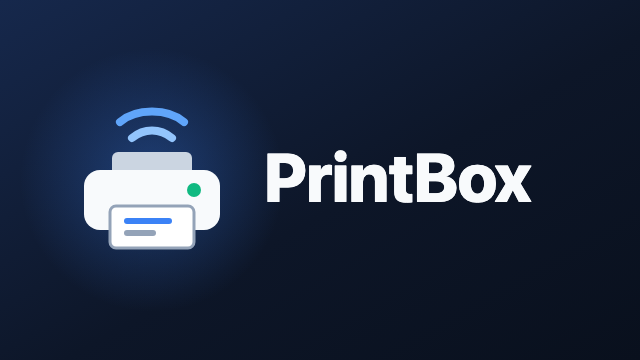
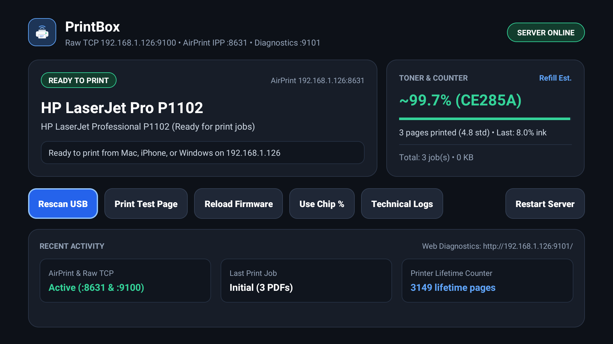

<p align="center">
  
</p>

# PrintBox

**PrintBox** turns an Android TV or Google TV box (tested on **Xiaomi Mi Box S**, Android 11) into a network **AirPrint**, **IPP Everywhere**, and **Raw TCP JetDirect** print server for host-based USB laser printers—built around the **HP LaserJet Professional P1102** family (`CE285A`).

Instead of relying on an always-on PC, PrintBox runs as a persistent Android foreground service, switches HP Smart Install virtual-CD printers into USB Printer mode, uploads printer firmware over USB, dithers incoming PDF/image/raster jobs in Kotlin, encodes ZjStream (JBIG1) via JNI, and tracks toner usage across refills and app updates.

<p align="center">
  
</p>

---

## Features

- **AirPrint & IPP Server (`:8631`):** Accepts `application/pdf`, `image/urf` (Apple URF), `image/pwg-raster` (PWG Raster), `image/jpeg`, `image/png`, and `image/webp` jobs over IPP (`AirPrintServer` + `jipp-core`).
- **Apple iOS / macOS Discovery (`mDNS`):** Publishes `_ipp._tcp,_print`, `_universal._sub._ipp._tcp` (via `JmDNS` for iOS AirPrint visibility), `_pdl-datastream._tcp.`, and `_printer._tcp.` (`NsdHelper`).
- **Raw TCP JetDirect Socket (`:9100`):** Streams raw `.zjs` / driver-rendered print jobs directly to the USB Bulk OUT endpoint (`RawPrintServer`).
- **HP Smart Install Bypass & Cold-Boot Firmware Upload (`PrinterManager`):**
  - Detects HP mass-storage Smart Install mode (`0x03F0`) and sends SCSI `0xD0` via USB Command Block Wrapper (CBW) to re-enumerate as USB Printer Class `7`.
  - Inspects IEEE-1284 Device ID (`FWVER:`) and uploads `app/src/main/assets/sihpP1102.dl` automatically when missing.
- **Halftone Rasterizer & Native ZjStream Encoder:**
  - Contrast-guarded Floyd-Steinberg halftoning (`HalftoneDither`) shared across PDF pages, `JPEG`/`PNG`/`WEBP` photos (with EXIF rotation), and 8/24-bit URF/PWG rasters (`AirPrintConverter`, `RasterToPbm`).
  - Encodes `P4` PBM bitmaps into HP ZjStream via JNI (`ZjsNative`, `libzjsencoder.so` in `app/src/main/cpp/`).
- **Chip Supply Query & Refill Toner Estimator (`PjlSupplyParser`, `RefillTracker`):**
  - Polls `@PJL INFO SUPPLIES`, `@PJL INFO PAGECOUNT`, and `@PJL INFO STATUS` over USB.
  - Because refilled `CE285A` chips remain locked at `0%` (`Used / LowReached`), Refill Mode estimates remaining toner at **0.1% precision** using actual dark-pixel coverage weighted against CE285A's `1,600`-page @ `5%` ISO yield, and exposes integer `marker-levels` over IPP.
- **Persistent Memory (`AppMemoryStore`):** Preserves completed job counts, transferred bytes, last-job metadata, cached printer lifetime pages, refill counter, and recent log history across app updates, service restarts, and TV reboots (`android:allowBackup="true"`, `android:hasFragileUserData="true"`).
- **Read-Only Web Diagnostics (`:9101`):** Plain-text status, attached USB descriptors, supply telemetry, and recent logs (`DiagnosticHttpServer`).
- **10-Foot Android TV Remote UI:** Single-screen D-pad dashboard (`layout-w600dp/activity_main.xml`) with **Rescan USB**, **Print Test Page** (`TestPageGenerator`), **Reload Firmware**, **Mark Refilled / Use Chip %**, **Technical Logs / Show Summary**, and **Restart Server**.

---

## Network Ports & Protocols

| Port | Service | Protocol / Endpoint | Purpose |
| :--- | :--- | :--- | :--- |
| `8631` | `AirPrintServer` | IPP/1.1 (`http://<tv-ip>:8631/ipp/print`) | Driverless printing from macOS, iOS, iPadOS, Linux, and CUPS |
| `9100` | `RawPrintServer` | AppSocket / JetDirect (`socket://<tv-ip>:9100`) | Raw driver stream passthrough from Windows, macOS, Linux |
| `9101` | `DiagnosticHttpServer` | HTTP GET (`http://<tv-ip>:9101/`) | Live printer state, USB device list, supply stats, and recent logs |

### mDNS Service Records

`NsdHelper` registers the following service types on the active IPv4 Wi-Fi/Ethernet interface:

- `_pdl-datastream._tcp.` (port `9100`)
- `_printer._tcp.` (port `9100`)
- `_ipp._tcp,_print` (port `8631`, Android `NsdManager`)
- `_universal._sub._ipp._tcp` (port `8631`, `JmDNS` subtype required by iOS AirPrint)

---

## Project Structure

```text
UsbPrintServer/
├── LICENSE                                  # MIT License (app/Kotlin sources)
├── README.md
├── CONTRIBUTING.md                          # Guide for adding printers, features & fixes
├── .gitignore
├── .github/
│   ├── PULL_REQUEST_TEMPLATE.md
│   └── ISSUE_TEMPLATE/
│       ├── config.yml
│       ├── new-printer.yml
│       ├── bug-report.yml
│       └── feature-request.yml
├── build.gradle.kts
├── settings.gradle.kts
├── gradle.properties
├── gradlew / gradlew.bat
├── docs/
│   └── images/
│       ├── printbox-banner.png              # 16:9 Android TV banner preview
│       └── printbox-tv-ui.png               # Live Mi Box S screenshot
├── scripts/
│   ├── deploy.sh                            # ADB-over-TCP deploy helper
│   └── profile_server.py                    # Optional HTTP server for iOS .mobileconfig profiles
└── app/
    ├── build.gradle.kts                     # compileSdk 36, minSdk 24, targetSdk 36, NDK 28.2
    ├── proguard-rules.pro
    └── src/
        ├── main/
        │   ├── AndroidManifest.xml
        │   ├── assets/
        │   │   └── sihpP1102.dl             # HP LaserJet P1102 cold-boot firmware payload
        │   ├── cpp/
        │   │   ├── CMakeLists.txt           # Builds libzjsencoder.so (armeabi-v7a, arm64-v8a)
        │   │   ├── foo2zjs_jni.c            # JNI wrapper encoding PBM -> ZjStream
        │   │   ├── jbig.c / jbig.h          # JBIG1 compression
        │   │   ├── jbig_ar.c / jbig_ar.h    # Arithmetic coder for JBIG1
        │   │   └── zjs.h                    # ZjStream protocol definitions
        │   ├── java/com/usbprint/server/
        │   │   ├── AirPrintConverter.kt     # PDF, image, and URF/PWG -> PBM -> ZJS pipeline
        │   │   ├── AirPrintServer.kt        # IPP/1.1 HTTP server & marker-* attributes
        │   │   ├── AppMemoryStore.kt        # SharedPreferences + file log persistence
        │   │   ├── AppState.kt              # StateFlow/SharedFlow state hub & refill helpers
        │   │   ├── BootReceiver.kt          # Starts PrintServerService on device boot
        │   │   ├── DiagnosticHttpServer.kt  # Plain-text diagnostics endpoint (:9101)
        │   │   ├── HalftoneDither.kt        # Floyd-Steinberg dithering & PbmStats coverage counter
        │   │   ├── MainActivity.kt          # D-pad TV dashboard controller
        │   │   ├── NsdHelper.kt             # NsdManager + JmDNS AirPrint registration
        │   │   ├── PjlSupplyParser.kt       # Parses @PJL INFO SUPPLIES and PAGECOUNT
        │   │   ├── PrintServerService.kt    # Foreground service, locks, and lifecycle owner
        │   │   ├── PrinterManager.kt        # USB Host, Smart Install switch, firmware & Bulk I/O
        │   │   ├── RasterToPbm.kt           # URF & PWG-Raster decoder
        │   │   ├── RawPrintServer.kt        # Raw TCP port 9100 socket server
        │   │   ├── RefillTracker.kt         # Coverage-weighted refill estimator (1600p @ 5%)
        │   │   ├── TestPageGenerator.kt     # Local A4 diagnostic PDF generator
        │   │   └── ZjsNative.kt             # System.loadLibrary("zjsencoder") JNI bridge
        │   └── res/
        │       ├── drawable/                # Icons, focusable TV button/card/pill shapes
        │       ├── drawable-v26/            # Adaptive launcher icon
        │       ├── drawable-xhdpi/          # 640x360 Leanback TV banner (ic_launcher_banner.png)
        │       ├── layout/                  # Compact fallback layout
        │       ├── layout-w600dp/           # Primary 10-foot TV dashboard layout
        │       ├── values/                  # Dark-theme colors, strings, TV theme
        │       └── xml/device_filter.xml    # USB filter (HP VID 0x03F0 + USB Printer Class 7)
        └── test/java/com/usbprint/server/
            ├── AirPrintConverterDitherTest.kt
            ├── PjlSupplyParserTest.kt
            ├── RasterToPbmTest.kt
            └── RefillTrackerTest.kt
```

---

## Requirements & Build Setup

### Prerequisites

- **JDK 17** (`compileOptions` / `jvmTarget = "17"`)
- **Android SDK** with `compileSdk = 36` (`minSdk = 24`, `targetSdk = 36`)
- **Android NDK `28.2.13676358`** and **CMake `3.22.1`** (for `libzjsencoder.so` targeting `armeabi-v7a` and `arm64-v8a`)
- Android TV / Android device with **USB Host** (`android.hardware.usb.host`) support

### Build & Run Unit Tests

```bash
./gradlew testDebugUnitTest assembleDebug
```

The debug APK is written to:

```text
app/build/outputs/apk/debug/app-debug.apk
```

Unit tests (`16` tests across `AirPrintConverterDitherTest`, `PjlSupplyParserTest`, `RasterToPbmTest`, and `RefillTrackerTest`) cover halftone dithering, PJL supply parsing, URF/PWG raster conversion + coverage metrics, direct image header detection, and refill percentage math.

### Deploy to an Android TV Box

1. Temporarily enable **Developer options** and **USB debugging** (plus ADB over TCP if needed) on the TV box.
2. Deploy via the helper script (defaulting to ADB port `5555`):

```bash
./scripts/deploy.sh <tv-ip>
```

> **Important (Mi Box S single-port hardware):** Many TV boxes share the USB port between ADB debugging and USB Host mode. After installing the APK over Wi-Fi ADB or cable, turn **USB Debugging OFF** so the Android TV USB Host controller can detect the HP printer when plugged in.

---

## Client Setup

Find your TV box IP address on the **PrintBox** screen or at `http://<tv-ip>:9101/`.

### macOS / iOS / iPadOS (AirPrint — Recommended)

1. Ensure the Apple device and TV box are on the same local Wi-Fi/LAN.
2. Open the print dialog and select **HP LaserJet Pro P1102 (MiBox)**.
3. No extra printer driver is needed—jobs arrive as `application/pdf` or `image/urf` on port `8631`.

*(If an iOS device on an isolated/VPN network needs a manual configuration profile, [`scripts/profile_server.py`](scripts/profile_server.py) can serve a local `.mobileconfig` file via `python3 scripts/profile_server.py /path/to/profile.mobileconfig`.)*

### Windows 10 / 11 (Raw TCP `:9100`)

1. Open **Settings** -> **Bluetooth & devices** -> **Printers & scanners** -> **Add device** -> **Add manually**.
2. Choose **Add a printer using an IP address or hostname**:
   - Device type: **TCP/IP Device**
   - Hostname or IP address: `<tv-ip>`
   - Uncheck **Query the printer and automatically select the driver to use**.
3. If prompted for custom port settings: Protocol **Raw**, Port **9100**.
4. Select the **HP LaserJet Professional P1102** driver and print a test page.

### Linux / CUPS

Driverless IPP:

```bash
lpadmin -p PrintBox_P1102 -E -v ipp://<tv-ip>:8631/ipp/print -m everywhere
```

Or JetDirect raw socket:

```bash
lpadmin -p HPP1102_Raw -E -v socket://<tv-ip>:9100 -m foomatic:HP-LaserJet_Professional_P1102-foo2xqx.ppd
```

### Command-Line Verification

Verify live IPP attributes (requires `ipptool` from CUPS):

```bash
ipptool -tv ipp://<tv-ip>:8631/ipp/print /usr/share/cups/ipptool/get-printer-attributes.test
```

Fetch diagnostics and recent service logs:

```bash
curl -s http://<tv-ip>:9101/
```

Send a pre-encoded ZJS/raw stream directly to port `9100`:

```bash
nc -w 5 <tv-ip> 9100 < sample.zjs
```

---

## Troubleshooting

- **Supply shows `0%` on the printer chip after refilling toner:**
  Refilling toner powder does not reprogram the single-use `CE285A` drum/cartridge chip, so `@PJL INFO SUPPLIES` continues to report `PercentRemaining = 0` (`Type = Used`, `LowReached = 1`). Leave **Refill Est.** active (or press **Mark Refilled** on the TV remote after a refill) to track local coverage-weighted usage from `100.0%`.
- **Printer is plugged in, but state stays `USB DISCONNECTED`:**
  Check that **USB Debugging** is disabled on Android TV boxes that multiplex ADB and USB Host on one USB-A port, confirm the printer power switch is ON, and press **Rescan USB** on the TV remote.
- **Cold-booted printer clicks/spins briefly before becoming `READY`:**
  Normal behavior—the HP P1102 requires `sihpP1102.dl` firmware uploaded on every power-on (`UPLOADING_FIRMWARE`), after which the status switches to `READY TO PRINT`.

---

## Contributing

Contributions are welcome—especially support for additional USB printers, protocol encoders, supply parsers, and TV UX improvements!

- Read **[CONTRIBUTING.md](CONTRIBUTING.md)** for the step-by-step guide on onboarding a new USB printer (`device_filter.xml`, `PrinterManager`, firmware handling, `AirPrintConverter`, `PjlSupplyParser`, and `NsdHelper`), adding features, and running verification checks.
- Open a **New Printer**, **Bug Report**, or **Feature Request** using [`.github/ISSUE_TEMPLATE/`](.github/ISSUE_TEMPLATE/), and follow [`.github/PULL_REQUEST_TEMPLATE.md`](.github/PULL_REQUEST_TEMPLATE.md) when submitting PRs.

---

## License & Third-Party Notices

- **PrintBox Android / Kotlin application & UI** (`app/src/main/java/`, `app/src/test/`, `app/src/main/res/`, `scripts/`): Licensed under the **[MIT License](LICENSE)**.
- **Native ZjStream & JBIG1 encoder (`app/src/main/cpp/`):**
  - `jbig.c`, `jbig.h`, `jbig_ar.c`, `jbig_ar.h`: Portable JBIG1 library by Markus Kuhn, licensed under the **GNU General Public License (GPL v2 or later)** (`app/src/main/cpp/jbig.c`).
  - `foo2zjs_jni.c` and `zjs.h`: Adapted from `foo2zjs` (Rick Richardson) for ZjStream generation.
  - Because `libzjsencoder.so` compiles GPL native C sources and links at runtime via JNI (`ZjsNative.kt`), redistributions of compiled binaries or combined native C changes must comply with the GPL terms for those native components.
- **Printer Firmware (`app/src/main/assets/sihpP1102.dl`):** Proprietary Hewlett-Packard LaserJet P1102 operating firmware binary. Check redistribution requirements in your jurisdiction or replace the asset with firmware extracted from HP's official driver package if distributing binaries externally.
